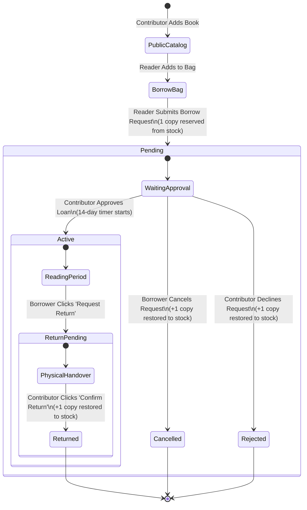

# 📚 BookNook — Peer-to-Peer Community Library Platform

[](https://nextjs.org/)
[](https://react.dev/)
[](https://tailwindcss.com/)
[](https://expressjs.com/)
[](https://www.mongodb.com/)
[](https://www.better-auth.com/)
[](https://biomejs.dev/)

> **BookNook** is a modern, peer-to-peer (P2P) community library and book sharing web application. Readers can discover physical books, reserve copies into a non-commercial borrow bag, and submit borrow requests directly to community book contributors. Contributors review and approve loans, while borrowers request returns that contributors verify upon physical receipt.

---

## 📑 Table of Contents

1. [🏛️ Architecture & Technologies](#️-architecture--technologies)
2. [✨ Core Features](#-core-features)
3. [🧩 Modular Component Architecture](#-modular-component-architecture)
4. [🛡️ Multi-Layer Private Route & Proxy Architecture](#️-multi-layer-private-route--proxy-architecture)
5. [🔄 Peer-to-Peer (P2P) Lending Lifecycle](#-peer-to-peer-p2p-lending-lifecycle)
6. [📖 User Guide & How to Use (ব্যবহার বিধি)](#-user-guide--how-to-use-ব্যবহার-বিধি)
7. [🔔 Toast Notification System](#-toast-notification-system)
8. [🔐 Authentication & Security](#-authentication--security)
9. [⚙️ Environment Variables (Unified Setup)](#️-environment-variables-unified-setup)
10. [🚀 Getting Started Locally](#-getting-started-locally)
11. [📂 Project Directory Structure](#-project-directory-structure)

---

## 🏛️ Architecture & Technologies

BookNook is built with a decoupled full-stack architecture pairing a Next.js 16 frontend with an Express 5 REST API and MongoDB Atlas.

### 🎨 Frontend (`booknook_client`)

| Technology | Version | Purpose & Description |
| :--- | :--- | :--- |
| **Next.js** | `16.4.3` | React Framework with App Router, Turbopack, Reverse API Proxy, and Server/Client Components |
| **React** | `19.3.0` | Core UI library powered by the React Compiler (`reactCompiler: true`) |
| **TypeScript** | `v5` | End-to-end static type safety and interface contracts |
| **Tailwind CSS** | `v4` | Modern CSS engine with `@theme` brand tokens in `src/app/globals.css` |
| **shadcn/ui** | `base-nova` | Accessible UI primitives built on top of `@base-ui/react` (no Radix) |
| **Sonner** | `2.0.8` | Toast notification system with rich colors, animations, and icons |
| **BetterAuth** | `1.7.14` | Client & server authentication, sessions, MongoDB adapter, and JWT plugin |
| **Lucide React** | `1.65.0` | Iconography throughout headers, cards, badges, and modals |
| **Biome** | `2.4.2` | Replacement for ESLint and Prettier for formatting and linting |

### 🛠️ Backend (`booksnook_backend`)

| Technology | Version | Purpose & Description |
| :--- | :--- | :--- |
| **Express.js** | `v5.0` | REST API routing and middleware management |
| **Node.js** | `v20+` | Server runtime with native ES Modules (`"type": "module"`) |
| **MongoDB Driver** | `7.8.0` | Native MongoDB driver for high-performance atomic BSON operations (no Mongoose bloat) |
| **jose** | `6.2.14` | Cryptographic JWT verification and JWKS validation |
| **dotenv** | `16.4.7` | Environment variable management |
| **cors** | `2.8.5` | Cross-Origin Resource Sharing with credentials support |

---

## ✨ Core Features

### 1. 📚 Public Catalog & Discovery (`/books`)
- **Multi-Criterion Sorting**: Sort books by Availability, Highest Rated, Most Copies Available, or Default order.
- **Client-Side Pagination**: Clean 8-book paginated grid with responsive page navigation.
- **Stock Indicators**: Real-time badges for *In Stock*, *Low Stock (≤2 copies)*, and *Out of Stock*.

### 2. 🔍 Single Book Details (`/books/[id]`)
- **Contributor Attribution**: Prominently displays the book contributor's name, email, and contribution date.
- **Copy Reservation Selector**: Dynamic quantity selector capped at available shelf inventory.
- **Self-Borrow Prevention**: Book contributors cannot borrow their own uploaded books; warning alerts and disabled buttons prevent accidental self-loans.
- **Live Inventory Counter**: Real-time counter reflecting reserved vs. available shelf copies.

### 3. 🛍️ Non-Commercial Borrow Bag (`CartSheet.tsx`)
- **Non-Commercial Design**: Strictly avoids e-commerce terms (*no prices, checkout carts, or payment buttons*).
- **Batch Borrow Requests**: Add multiple books to your bag and submit a unified loan request.
- **Quantity Adjuster**: Increment, decrement, or remove items with automatic available stock limits.
- **Return Due Date Calculation**: Calculates and previews the standard 14-day borrowing loan window.

### 4. 🤝 Peer-to-Peer (P2P) Lending & Approvals (`/my-books`)
- **Contributor Dashboard**: Books uploaded by the user with 4 aggregate metrics:
  - **Total Titles**: Contributed catalog titles.
  - **Total Copies**: Aggregate physical inventory across all titles.
  - **Available Copies**: Copies currently on library shelves ready for loan.
  - **Currently Loaned**: $\text{Total Copies} - \text{Available Copies}$.
- **Incoming Requests Tab**: Review reader borrow requests:
  - **Approve**: Activates the loan and begins the 14-day countdown.
  - **Decline**: Declines the request and immediately releases reserved copies back to public shelf inventory.
- **Return Approvals Tab**: Verify when readers return books in person:
  - **Confirm Return**: Marks loan as `Returned` and increments available copies.
- **Book Edit Modal**: Update title, author, category, description, and total copies with active-loan lower bound safeguards.
- **Safe Deletion**: Permanently blocks deleting books while active or pending loans exist.

### 5. 📖 Reader Loans Dashboard (`/my-borrows`)
- **Status Filter Tabs**: Filter by *All*, *Pending*, *Active*, *Return Pending*, and *Returned*.
- **Search Bar**: Search borrowed books by title, author, or contributor name.
- **Countdown Due Timers**: Real-time visual tracking of loan due dates with *Active*, *Due Today*, or *Overdue* states.
- **Borrower Actions**:
  - **Cancel Request**: Cancel pending borrow requests before contributor approval, instantly restoring copies.
  - **Request Return**: Initiate book return when ready to return physical copies.

### 6. 👤 User Profile & Activity Hub (`/profile`)
- **Dynamic Avatar with Gmail Fallback**: Renders user profile picture, automatically queries public avatar via `unavatar.io` for Gmail/email accounts, or falls back to stylized initials.
- **Reading Activity Summary**: Metric cards for Active Loans, Total Borrowed, Completed, and My Contributions.
- **Reader Credentials Card**: Displays member status, borrowing quota (up to 3 concurrent books), standard loan period (14 days), and JWT verified badge.
- **Recent Borrow Activity**: Preview of recent books with real-time loan status badges.

---

## 🧩 Modular Component Architecture

To maintain high maintainability, readability, and performance, large route monoliths were decomposed into clean, single-responsibility sub-components:

| Route Directory | Coordinator | Sub-Components (`components/`) |
| :--- | :--- | :--- |
| **`/my-books`** | `MyBooksClient.tsx` (~210 lines) | `BookThumbnail.tsx`, `ContributorHeader.tsx`, `CatalogStats.tsx`, `CatalogTable.tsx`, `RequestsStats.tsx`, `RequestsTable.tsx`, `EditBookModal.tsx`, `DeleteBookModal.tsx` |
| **`/my-borrows`** | `MyBorrowsClient.tsx` (~160 lines) | `BorrowBookThumbnail.tsx`, `BorrowsHeader.tsx`, `BorrowsFilterBar.tsx`, `BorrowsTable.tsx` |
| **`/profile`** | `ProfileClient.tsx` (~95 lines) | `ProfileBookThumbnail.tsx`, `ProfileHeader.tsx`, `ProfileStats.tsx`, `AccountDetails.tsx`, `RecentBorrowActivity.tsx` |

All sub-components are cleanly exported via local `index.ts` barrel files.

---

## 🛡️ Multi-Layer Private Route & Proxy Architecture

BookNook utilizes a **3-Layer Defense-in-Depth** security model:

```
                       [Incoming Request]
                               │
    ┌──────────────────────────▼──────────────────────────┐
    │ 1. Next.js Server Edge Middleware (src/middleware.ts)│ ◄── Instant 307 redirect before page execution
    └──────────────────────────┬──────────────────────────┘
                               │
    ┌──────────────────────────▼──────────────────────────┐
    │ 2. Client Guard Wrapper (ProtectedRoute.tsx)        │ ◄── Handles session hydration & token expiry
    └──────────────────────────┬──────────────────────────┘
                               │
    ┌──────────────────────────▼──────────────────────────┐
    │ 3. Express REST API (authenticate.ts)               │ ◄── Cryptographic JWT Bearer verification
    └─────────────────────────────────────────────────────┘
```

### Next.js Reverse API Proxy
Configured in [`next.config.ts`](file:///c:/Project/Assignment-08/booknook_client/next.config.ts):
```ts
async rewrites() {
  const backendUrl = process.env.API_URL || "http://localhost:8000";
  return [
    {
      source: "/api/backend/:path*",
      destination: `${backendUrl}/:path*`,
    },
  ];
}
```
- **Same-Origin Requests**: Browser requests stay strictly same-origin (`/api/backend/...`), eliminating CORS preflight `OPTIONS` requests.
- **Dual-Environment Resolution**: `API_BASE_URL` resolves to `/api/backend` on the client (browser) and direct `API_URL` during Server Component SSR.
- **Smart JWT Caching**: Active JWTs are cached in memory with a 30s TTL buffer to eliminate duplicate auth token round-trips across parallel service calls.

---

## 🔄 Peer-to-Peer (P2P) Lending Lifecycle



---

## 📖 User Guide & How to Use (ব্যবহার বিধি)

### ১. বই অনুসন্ধান ও ব্রাউজিং (Browse & Search)
1. **হেডার সার্চবার**: পৃষ্ঠার শীর্ষে থাকা সার্চবারে বইয়ের নাম, লেখক বা ক্যাটাগরি লিখে দ্রুত ড্রপডাউন ফলাফল দেখুন।
2. **ক্যাটালগ পেজ (`/books`)**: সর্টিং ড্রপডাউন ব্যবহার করে বইয়ের তালিকা দেখুন ও পেজিনেশন দিয়ে পৃষ্ঠা পরিবর্তন করুন।

### ২. বই ধার নেওয়ার আবেদন (Requesting a Book Loan)
1. বইয়ের কার্ডে **"Borrow"** বাটনে অথবা বইয়ের বিস্তারিত পেজে (`/books/[id]`) গিয়ে **"Add to Bag"** চাপুন।
2. হেডারের **ব্যাগ আইকন (Borrow Bag)**-এ ক্লিক করে আপনার সংরক্ষিত বইয়ের তালিকা পরীক্ষা করুন।
3. **"Confirm Borrow Request"** বাটনে চাপুন।
4. সাথে সাথে বইটির ১টি কপি ইনভেন্টরি থেকে সাময়িকভাবে রিজার্ভ হবে এবং স্ট্যাটাস হবে **`Pending`**।
5. আপনি আপনার **`My Borrows`** পেজে গিয়ে পেন্ডিং রিকোয়েস্টটি দেখতে পারবেন এবং চাইলে কনট্রিবিউটর অনুমোদন করার পূর্বে তা **Cancel** করতে পারবেন।

### ৩. কনট্রিবিউটরের অনুমোদন ও রিটার্ন নিশ্চিতকরণ (Contributor Workflow)
1. আপনি যেসব বই আপলোড করেছেন, সেগুলোর জন্য রিকোয়েস্ট আসলে **`My Books`** পেজের **Incoming Requests** ট্যাবে দেখতে পাবেন।
2. **Approve**: রিকোয়েস্টটি অনুমোদন করলে বইটির লোন সক্রিয় হবে এবং ১৪ দিনের রিটার্ন মেয়াদ গণনা শুরু হবে।
3. **Decline**: রিকোয়েস্ট বাতিল করলে সংরক্ষিত কপিটি পুনরায় জনসাধারণের জন্য ক্যাটালগে যুক্ত হবে।
4. পাঠক বই ফেরত দিতে চাইলে তা **Incoming Requests**-এর রিটার্ন সেকশনে আসবে। বই হাতে পাওয়ার পর **"Confirm Return Received"** বাটনে চাপলেই লোন সমাপ্ত হবে এবং বইটির স্টক পুনরুদ্ধার হবে।

### ৪. নতুন বই যুক্ত ও সম্পাদনা (Adding & Managing Books)
1. **নতুন বই যোগ (`/add-book`)**: শিরোনাম, লেখক, ধরণ, কপির সংখ্যা এবং কভার ছবির লিঙ্ক দিয়ে বই আপলোড করুন।
2. **বই সম্পাদনা (`/my-books`)**: আপনার বইয়ের বিবরণ ও কপির সংখ্যা পরিবর্তন করুন (চলমান লোনের চেয়ে কম কপিতে নামানো যাবে না)।
3. **বই ডিলিট (`/my-books`)**: কোনো চলমান বা পেন্ডিং লোন না থাকলে বইটি মুছে ফেলতে পারবেন।

---

## 🔔 Toast Notification System

BookNook-এ **Sonner** লাইব্রেরির মাধ্যমে একটি সম্পূর্ণ ইন্টিগ্রেটেড গ্লোবাল টোস্ট সিস্টেম যুক্ত রয়েছে:

- 🟢 **Success Toasts**: বই ব্যাগে যুক্ত করা, ধার রিকোয়েস্ট নিশ্চিত করা, নতুন বই যোগ করা, বই এডিট/ডিলিট, রিকোয়েস্ট অ্যাপ্রুভ এবং লগইন/রেজিস্ট্রেশন সাফল্য।
- 🔴 **Error Toasts**: স্টক না থাকা, লগইন ছাড়া ধার করার চেষ্টা, অবৈধ ইনপুট ভ্যালিডেশন এবং এপিআই ব্যর্থতা।
- 🟡 **Warning Toasts**: নিজের আপলোড করা বই নিজে ধার করার চেষ্টা করলে সতর্কবার্তা।
- 🔵 **Info Toasts**: ব্যাগ থেকে বই বাদ দেওয়া বা ব্যাগ খালি করার নোটিফিকেশন।

---

## 🔐 Authentication & Security

- **দ্বৈত অথেনটিকেশন**:
  - **ইমেইল ও পাসওয়ার্ড**: সর্বনিম্ন ৬ অক্ষর, কমপক্ষে একটি বড় হাতের ও একটি ছোট হাতের অক্ষরের কঠোর ভ্যালিডেশন।
  - **গুগল ও-অথ (Google OAuth 2.0)**: গুগল ক্লাউড কনসোলের মাধ্যমে এক ক্লিকে নিরাপদ সোশ্যাল সাইন-ইন।
- **স্টেটলেস JWT ভেরিফিকেশন**: Better-Auth ফ্রন্টএন্ডে সেশন তৈরি করে এবং ব্যাকএন্ডের জন্য ক্রিপ্টোগ্রাফিকালি সাইন করা JWT টোকেন ইস্যু করে (`Authorization: Bearer <token>`)।
- **নিরাপদ রাউট গার্ড (`ProtectedRoute` + `src/middleware.ts`)**: অননুমোদিত ব্যবহারকারীদের স্বয়ংক্রিয়ভাবে রিডাইরেক্ট করে লগইন পেজে নিয়ে যায়।

---

## ⚙️ Environment Variables (Unified Setup)

### ফ্রন্টএন্ড (`booknook_client/.env`)

```env
# Development Environment Variables
API_URL=http://localhost:8000
APP_URL=http://localhost:3000
BETTER_AUTH_SECRET=A6aErmnfAplYP1ZxrLMyAPzbsRlzcbTr
MONGODB_URI=mongodb+srv://<username>:<password>@cluster0.p16xpfx.mongodb.net/
GOOGLE_CLIENT_ID=your_google_client_id.apps.googleusercontent.com
GOOGLE_CLIENT_SECRET=your_google_client_secret
```

### ব্যাকএন্ড (`booksnook_backend/.env`)

```env
PORT=8000
NODE_ENV=development
API_URL=http://localhost:8000
APP_URL=http://localhost:3000
BETTER_AUTH_SECRET=A6aErmnfAplYP1ZxrLMyAPzbsRlzcbTr
MONGODB_URI=mongodb+srv://<username>:<password>@cluster0.p16xpfx.mongodb.net/
DB_NAME=assignment-08
```

---

## 🚀 Getting Started Locally

### ১. ফ্রন্টএন্ড চালানো (`booknook_client`)
```bash
# ডিপেনডেন্সি ইনস্টল করুন
npm install

# ডেভেলপমেন্ট সার্ভার চালু করুন (Turbopack)
npm run dev
```
ব্রাউজারে ওপেন করুন: [http://localhost:3000](http://localhost:3000)

### ২. ব্যাকএন্ড চালানো (`booksnook_backend`)
```bash
# ব্যাকএন্ড ফোল্ডারে যান
cd ../booksnook_backend

# ডিপেনডেন্সি ইনস্টল করুন
npm install

# ডেভেলপমেন্ট সার্ভার চালু করুন
npm run dev
```
ব্যাকএন্ড এপিআই চালু হবে: [http://localhost:8000](http://localhost:8000)

### ৩. কোড যাচাই ও ফরম্যাটিং
```bash
# ফ্রন্টএন্ড লিন্ট ও ফরম্যাট চেক (Biome)
npm run lint

# অটো-ফিক্স ও ফরম্যাট
npx biome check --write src

# ব্যাকএন্ড টাইপচেক
npx tsc --noEmit
```

---

## 📂 Project Directory Structure

```
booknook_client/
├── public/                    # স্ট্যাটিক অ্যাসেট ও সিড ডাটা
├── src/
│   ├── app/                   # Next.js 16 App Router পেজ ও এপিআই
│   │   ├── add-book/          # নতুন বই যুক্ত করার ফর্ম (AddBookForm)
│   │   ├── api/auth/          # BetterAuth হ্যান্ডলার
│   │   ├── books/             # পাবলিক ক্যাটালগ (BooksCatalog) ও বিস্তারিত পেজ [id]
│   │   ├── login/             # ইমেইল ও গুগল ও-অথ লগইন পেজ (LoginForm)
│   │   ├── my-books/          # কনট্রিবিউটর ড্যাশবোর্ড ও ৮টি মডুলার কম্পোনেন্ট
│   │   │   ├── components/    # BookThumbnail, ContributorHeader, CatalogStats, etc.
│   │   │   └── MyBooksClient.tsx
│   │   ├── my-borrows/        # পাঠকের ধার তালিকা ও ৪টি মডুলার কম্পোনেন্ট
│   │   │   ├── components/    # BorrowBookThumbnail, BorrowsHeader, BorrowsTable, etc.
│   │   │   └── MyBorrowsClient.tsx
│   │   ├── profile/           # প্রোফাইল সারাংশ ও ৫টি মডুলার কম্পোনেন্ট
│   │   │   ├── components/    # ProfileHeader, ProfileStats, AccountDetails, etc.
│   │   │   └── ProfileClient.tsx
│   │   ├── register/          # নতুন অ্যাকাউন্ট খোলার পেজ (RegisterForm)
│   │   ├── globals.css        # Tailwind v4 থিম ও কালার টোকেন
│   │   └── layout.tsx         # গ্লোবাল লেআউট ও Sonner Toaster
│   ├── components/            # রিইউজেবল রিঅ্যাক্ট কম্পোনেন্ট
│   │   ├── auth/              # ProtectedRoute কম্পোনেন্ট
│   │   ├── books/             # BookCard, RecentBooksShowcase
│   │   ├── header/            # Navbar, CartSheet, SearchBar, UserMenu
│   │   ├── home/              # Banner, LiterarySpotlight, ReadingPerks
│   │   └── ui/                # shadcn base-nova ও Sonner কম্পোনেন্ট
│   ├── lib/                   # Auth কনফিগারেশন, JWT ক্যাশ ও ক্লায়েন্ট
│   ├── middleware.ts          # Server Edge Route Guard
│   ├── providers/             # CartProvider ও গ্লোবাল স্টেট
│   ├── services/              # ডুয়াল-এনভায়রনমেন্ট এপিআই সার্ভিসেস (CRUD & Approval)
│   └── types/                 # TypeScript টাইপ ও ইন্টারফেস
├── biome.json                 # Biome 2 কনফিগারেশন
├── next.config.ts             # Next.js 16 কনফিগারেশন ও Reverse Proxy
└── package.json
```

---

## 👨‍💻 Developer & Attribution

- **Project**: BookNook — Assignment 08 Community Library
- **Author**: Muhammad Sakib
- **License**: MIT
