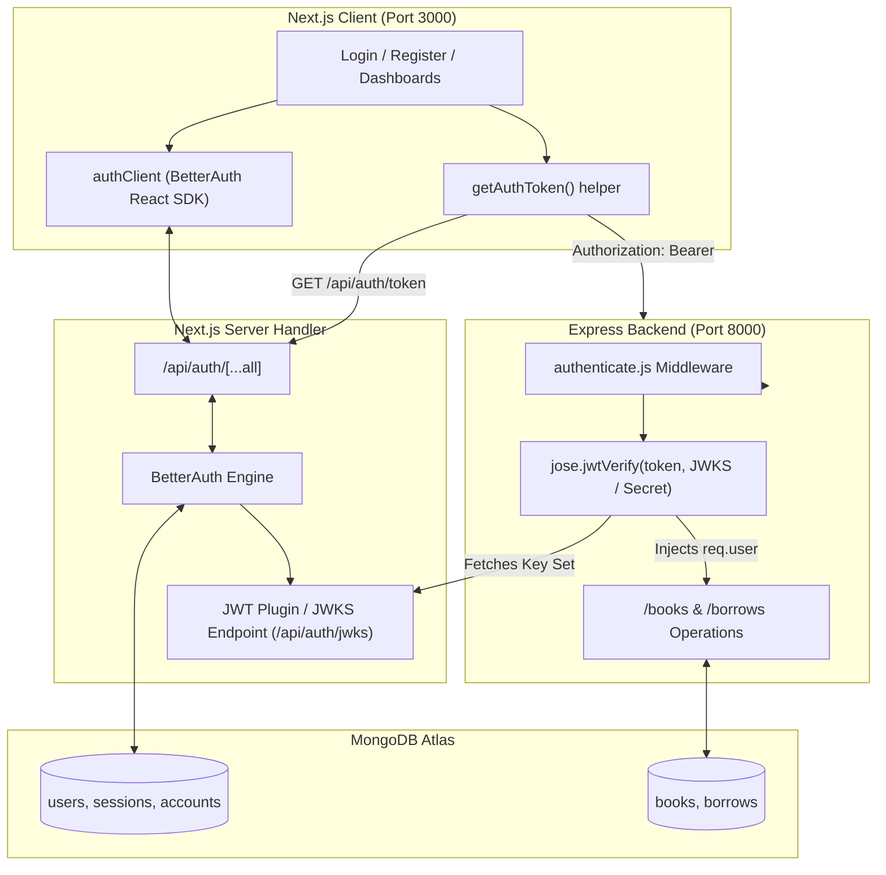

# BookNook — Authentication, JWT & Security Architecture

**Version**: 1.0.0 (Phase 03 Security Implementation)  
**Authentication Engine**: BetterAuth 1.7.14  
**JWT Verification**: `jose` (Asymmetric JWKS & Symmetric Fallback)  
**Database**: MongoDB (`assignment-08`)  

---

## 1. Authentication Architecture Overview

BookNook establishes a cryptographically verified security boundary between the Next.js 16 frontend and the Express.js 5 backend API:



---

## 2. Authentication Flows

### 2.1. Registration Flow
1. User visits `/register`.
2. Enforces password validation on the client:
   - At least 6 characters.
   - At least one uppercase letter (`[A-Z]`).
   - At least one lowercase letter (`[a-z]`).
3. Submits via `signUp.email({ name, email, password })` to `/api/auth/sign-up/email`.
4. BetterAuth securely hashes password using salt and stores record in `users` and `accounts` collections.
5. Issues session cookie (`better-auth.session_token`).
6. Frontend navigates to the intended destination or `/` upon success.

### 2.2. Login Flow
1. User visits `/login` (optionally with `?redirect=/add-book`).
2. Submits email and password via `signIn.email({ email, password })`.
3. BetterAuth verifies password hash.
4. On success, session cookie is stored in browser.
5. User is seamlessly redirected back to their intended protected page (`/add-book`, `/my-books`, or `/my-borrows`).

### 2.3. Google OAuth Flow
1. User clicks "Continue with Google" on `/login`.
2. Frontend triggers `signIn.social({ provider: "google" })`.
3. Redirects to Google OAuth consent screen.
4. Google returns authorization code to `/api/auth/callback/google`.
5. BetterAuth exchanges code for Google profile tokens, creates/links user account, and creates session.
6. *Note*: In environments where `GOOGLE_CLIENT_ID` or `GOOGLE_CLIENT_SECRET` are unconfigured, social sign-in gracefully displays a friendly fallback notification.

---

## 3. Session & JWT Lifecycle

### 3.1. Session Token vs. API JWT
- **Session Cookie (`better-auth.session_token`)**:
  - `HttpOnly`, `SameSite=Lax`, secure cookie used for browser session persistence with Next.js.
  - Not sent directly to Express.
- **Short-Lived API JWT**:
  - Issued by the BetterAuth JWT plugin at `/api/auth/token`.
  - Expiration lifetime: **15 minutes**.
  - Payload claims:
    - `sub`: Verified User ID (MongoDB `_id`).
    - `email`: Verified User Email.
    - `name`: User Display Name.
    - `role`: Role (`"reader"` or `"librarian"`).
    - `iss`: Issuer (`http://localhost:3000`).
    - `aud`: Audience (`http://localhost:8000`).
    - `exp`: Expiration timestamp.

### 3.2. JWKS & Cryptographic Verification in Express
The Express middleware ([`authenticate.js`](file:///c:/Project/Assignment-08/booksnook_backend/middleware/authenticate.js)):
1. Reads `Authorization: Bearer <token>`.
2. Verifies cryptographic signature using `jose.jwtVerify()` against the BetterAuth JWKS endpoint (`http://localhost:3000/api/auth/jwks`) with fallback to shared `BETTER_AUTH_SECRET`.
3. Verifies `iss === "http://localhost:3000"`, `aud === "http://localhost:8000"`, and validates expiration.
4. Injects verified identity into `req.user`:
   ```javascript
   req.user = {
     id: verifiedPayload.sub,
     email: verifiedPayload.email,
     name: verifiedPayload.name,
     role: verifiedPayload.role || "reader",
   };
   ```
5. If invalid, expired, or missing: returns `401 Unauthorized`.

---

## 4. Ownership Authorization Rules

All private database operations verify identity server-side:

| Operation | Endpoint | Ownership Rule |
| :--- | :--- | :--- |
| **Add Book** | `POST /books` | Server automatically sets `ownerUserId = req.user.id`, `addedByName = req.user.name`, `addedByEmail = req.user.email`. |
| **Edit Book** | `PUT /books/:id` | Allowed only if `book.ownerUserId === req.user.id` or `req.user.role === "librarian"`. Otherwise `403 FORBIDDEN`. |
| **Delete Book**| `DELETE /books/:id` | Allowed only if `book.ownerUserId === req.user.id` or `req.user.role === "librarian"`. Blocked if active loans exist. |
| **Borrow Book**| `POST /borrows` | Injects `userId = req.user.id`, `userEmail = req.user.email`. Rejects duplicate active loans. |
| **View Borrows**| `GET /borrows` | Readers are restricted to `{ userId: req.user.id }`. Cannot view loans belonging to others. |
| **Return Book**| `PUT /borrows/:id/return` | Allowed only if `borrow.userId === req.user.id` or `req.user.role === "librarian"`. |

---

## 5. Protected Client Routes & Redirection

Client routes are wrapped in [`<ProtectedRoute>`](file:///c:/Project/Assignment-08/booknook_client/src/components/auth/ProtectedRoute.tsx):
- `/add-book`
- `/my-books`
- `/my-borrows`

When an unauthenticated guest navigates to any of these routes:
1. Shows verification spinner while checking session.
2. If no session exists, redirects to:
   ```
   /login?redirect=/intended-destination
   ```
3. Upon successful sign-in, Next.js restores the user directly to `/intended-destination`.

---

## 6. Known Limitations & Production Guidance
1. **Google OAuth Credentials**:
   - In local development, Google OAuth requires registering a valid OAuth 2.0 Client ID in the Google Cloud Console and supplying `GOOGLE_CLIENT_ID` and `GOOGLE_CLIENT_SECRET`. If not configured, email/password registration and login remain 100% operational.
2. **Short-Lived Token Refresh**:
   - The API JWT token lasts 15 minutes. For long-running user sessions, `getAuthToken()` refreshes the token on demand via the valid BetterAuth session cookie.
3. **CORS Whitelisting**:
   - Express only accepts requests from `ALLOWED_ORIGIN` (configured to `http://localhost:3000` in local dev and Vercel production domain on Render).

---

*Report filed in `docs/AUTHENTICATION_ARCHITECTURE.md`.*

