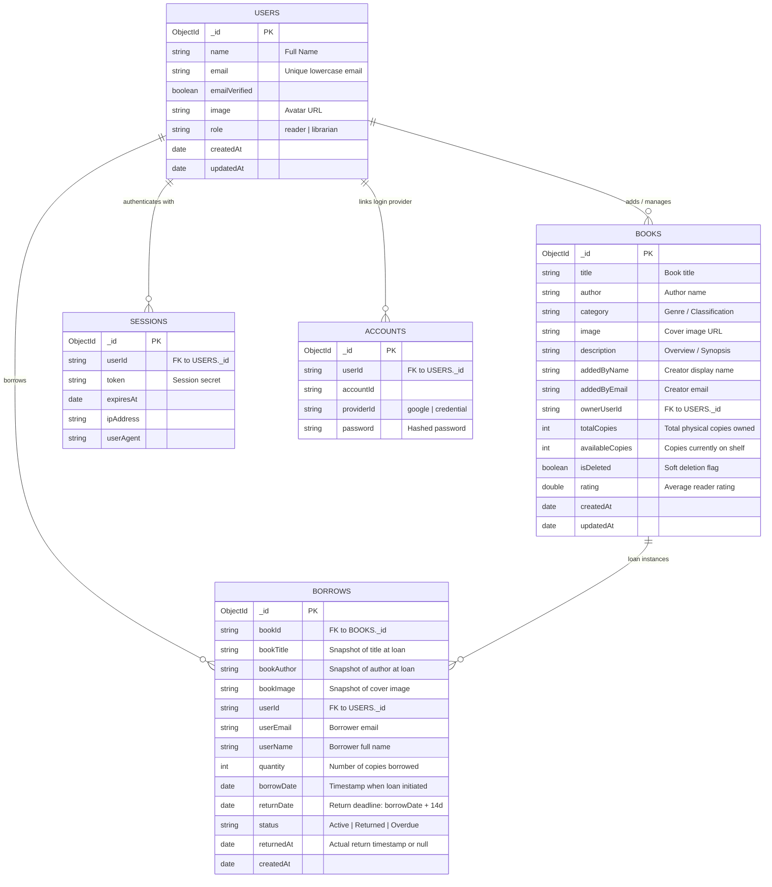

# BookNook — Database Schema & Data Dictionary

**Version**: 1.0.0 (Phase 02 Architecture Contract)  
**Database**: MongoDB (`assignment-08`)  
**Driver**: Official MongoDB Node.js Native Driver (`mongodb` v7.8)  

---

## 1. Entity-Relationship Model (ERD)



---

## 2. Collections Specification

### 2.1. `books` Collection
Stores physical book inventory titles registered in the library catalog.

| Field | Type | Required | Default | Description / Business Constraints |
| :--- | :--- | :---: | :--- | :--- |
| `_id` | `ObjectId` | Yes | Auto | Unique book identifier generated by MongoDB. |
| `title` | `String` | Yes | — | Book title. Must be non-empty string, trimmed (1–200 chars). |
| `author` | `String` | Yes | — | Author name. Trimmed string (1–120 chars). |
| `category` | `String` | Yes | `"General"` | Literary genre (e.g., Fiction, Sci-Fi, Mystery, Technology). |
| `image` | `String` | Yes | Fallback URL | HTTPS URL pointing to book cover image. |
| `description` | `String` | No | `""` | Book synopsis or overview. |
| `addedByName` | `String` | Yes | `"Librarian"` | Display name of the user who contributed the book. |
| `addedByEmail` | `String` | Yes | — | Email of the user who contributed the book. |
| `ownerUserId` | `String` | Yes | — | Foreign key referencing the contributing `users._id`. |
| `totalCopies` | `Number (Int)` | Yes | `5` | Total inventory volumes owned by the library ($\ge 1$). |
| `availableCopies` | `Number (Int)` | Yes | `= totalCopies` | Physical volumes available to borrow ($0 \le \text{available} \le \text{total}$). |
| `isDeleted` | `Boolean` | Yes | `false` | Soft-delete flag. When `true`, hidden from catalog while keeping active loans safe. |
| `rating` | `Number` | No | `4.8` | Quality rating from 1.0 to 5.0. |
| `createdAt` | `Date` (ISO) | Yes | `now()` | Timestamp of initial catalog registration. |
| `updatedAt` | `Date` (ISO) | Yes | `now()` | Timestamp of last modification. |

#### Legacy Aliases Maintained for Backward Compatibility:
- `copies`: Mirrors `totalCopies`.
- `genre`: Falls back to `category`.
- `bookTitle` / `name`: Falls back to `title`.
- `authorName`: Falls back to `author`.
- `status`: Derived dynamically (`availableCopies > 0 ? "Available" : "Unavailable"`).
- `available`: Derived dynamically (`availableCopies > 0`).

---

### 2.2. `borrows` Collection
Stores the legal loan contract between a reader and the library.

| Field | Type | Required | Default | Description / Business Constraints |
| :--- | :--- | :---: | :--- | :--- |
| `_id` | `ObjectId` | Yes | Auto | Unique borrow transaction identifier. |
| `bookId` | `String` | Yes | — | Foreign key reference to target `books._id`. |
| `bookTitle` | `String` | Yes | — | Immutable title snapshot at moment of borrowing. |
| `bookAuthor` | `String` | Yes | — | Immutable author snapshot at moment of borrowing. |
| `bookImage` | `String` | No | — | Immutable cover snapshot. |
| `userId` | `String` | Yes | — | Foreign key reference to the borrowing `users._id`. |
| `userEmail` | `String` | Yes | — | Verified email address of borrower. |
| `userName` | `String` | Yes | — | Verified display name of borrower. |
| `quantity` | `Number (Int)` | Yes | `1` | Number of physical copies borrowed in this transaction ($\ge 1$). |
| `borrowDate` | `Date` (ISO) | Yes | `now()` | Exact timestamp when loan was authorized. |
| `returnDate` | `Date` (ISO) | Yes | `+14 days` | Mandatory return deadline: $\text{borrowDate} + 14 \text{ calendar days}$. |
| `status` | `String` | Yes | `"Active"` | Loan lifecycle state: `"Active"`, `"Returned"`, or `"Overdue"`. |
| `returnedAt` | `Date` (ISO) | No | `null` | Exact timestamp when book was returned and checked into inventory. |
| `createdAt` | `Date` (ISO) | Yes | `now()` | Transaction creation timestamp. |

---

### 2.3. BetterAuth Collections
Generated and maintained by BetterAuth using native MongoDB adapter:
- **`user`**: User identity, roles (`"reader"` or `"librarian"`), name, email.
- **`session`**: Active login sessions, tokens, user agents, expiration dates.
- **`account`**: Authentication provider links (Google OAuth IDs or salt-hashed passwords).
- **`verification`**: Temporary verification codes (e.g., password resets, email verification).

---

## 3. Database Indexing Strategy

Optimal indexes ensure fast queries, eliminate full-collection scans, and enforce data integrity at the database engine level.

### 3.1. `books` Collection Indexes

```javascript
// 1. Primary sorting index for homepage and latest arrivals
db.books.createIndex({ createdAt: -1 }, { name: "idx_books_created_at_desc" });

// 2. Index for filtering active vs soft-deleted books by category
db.books.createIndex({ category: 1, isDeleted: 1 }, { name: "idx_books_category_active" });

// 3. Index for "My Books" dashboard queries by owner
db.books.createIndex({ ownerUserId: 1, isDeleted: 1 }, { name: "idx_books_owner_active" });

// 4. Text index for rapid keyword search on title and author
db.books.createIndex(
  { title: "text", author: "text" },
  { name: "idx_books_search_text", weights: { title: 10, author: 5 } }
);
```

### 3.2. `borrows` Collection Indexes

```javascript
// 1. Index for "My Borrows" reader dashboard (lookup by user and status)
db.borrows.createIndex({ userId: 1, status: 1 }, { name: "idx_borrows_user_status" });

// 2. Index for active loan checks before deleting books or checking inventory
db.borrows.createIndex({ bookId: 1, status: 1 }, { name: "idx_borrows_book_status" });

// 3. Partial Unique Index: Prevents a reader from having duplicate active loans of the SAME title
db.borrows.createIndex(
  { userId: 1, bookId: 1 },
  {
    unique: true,
    partialFilterExpression: { status: "Active" },
    name: "idx_borrows_unique_active_loan"
  }
);
```
> **Bangla Explanation (বাংলা ব্যাখ্যা)**:  
> `idx_borrows_unique_active_loan` একটি পার্শিয়াল ইউনিক ইনডেক্স। একজন পাঠক একটি বই ধার নিয়ে তা পড়া শেষ না করা পর্যন্ত (status="Active" থাকা অবস্থায়) একই বই দ্বিতীয়বার ধার নিতে পারবেন না। কিন্তু বই ফেরত দেওয়ার পর (status="Returned") তিনি প্রয়োজনে ভবিষ্যতে আবার বইটি ধার নিতে পারবেন।

---

## 4. Legacy Data Migration Strategy

Existing records in MongoDB may lack new canonical fields (`isDeleted`, `ownerUserId`, `addedByName`, `addedByEmail`). A non-destructive migration script will run safely:

```javascript
// Migration Query: Safely sets defaults for existing books without overwriting existing data
db.books.updateMany(
  { isDeleted: { $exists: false } },
  {
    $set: {
      isDeleted: false,
      addedByName: "Library Admin",
      addedByEmail: "admin@booknook.com",
      ownerUserId: "system-seed"
    }
  }
);

// Ensures totalCopies and availableCopies exist as numeric fields
db.books.find({ totalCopies: { $exists: false } }).forEach(function(doc) {
  var total = typeof doc.copies === "number" ? doc.copies : 5;
  var available = typeof doc.availableCopies === "number" ? doc.availableCopies : total;
  db.books.updateOne(
    { _id: doc._id },
    { $set: { totalCopies: total, availableCopies: available } }
  );
});
```

---

*Specification authored in accordance with Phase 02 requirements.*

