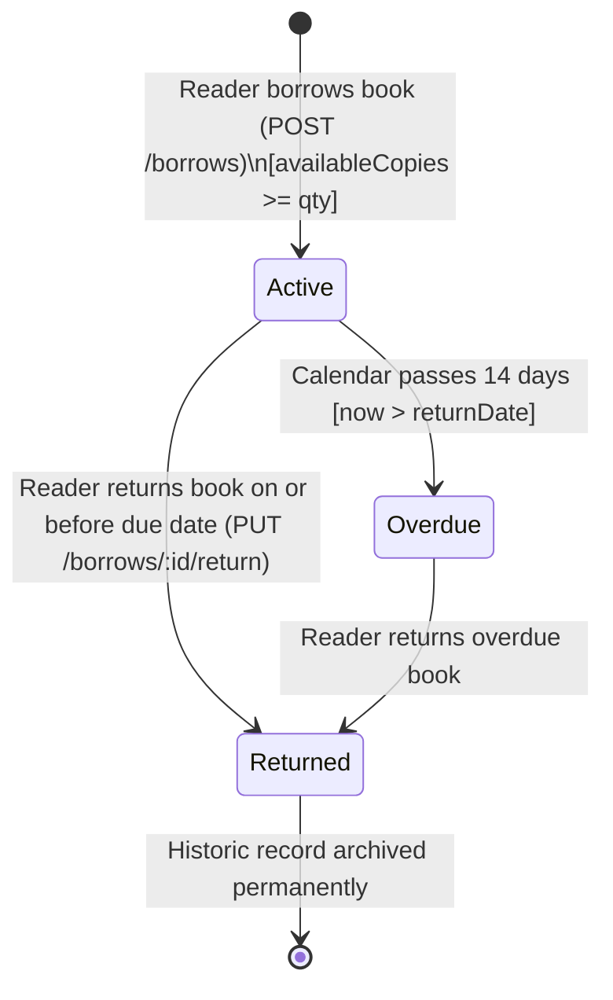

# BookNook — Inventory & Borrowing Business Rules Specification

**Version**: 1.0.0 (Phase 02 Architecture Contract)  
**Domain**: Library Physical Inventory Lifecycle & Loan Management  

---

## 1. The Fundamental Inventory Invariants

Every physical book title in BookNook obeys strict mathematical invariants that the database and backend services must uphold under all concurrent access conditions.

### Invariant 1: Inventory Balance Equation
$$\text{availableCopies} = \text{totalCopies} - \sum_{\text{active loans}} \text{borrowed quantity}$$

### Invariant 2: Shelf Availability Boundaries
$$0 \le \text{availableCopies} \le \text{totalCopies}$$

> **Bangla Explanation (সহজ বাংলায় মূল নিয়ম)**:  
> লাইব্রেরিতে মোট যতগুলো বইয়ের কপি আছে (`totalCopies`), তার থেকে বর্তমানে পাঠকদের হাতে থাকা ধার দেওয়া বইয়ের যোগফল বিয়োগ করলেই তাকের অবশিষ্ট ফাঁকা বই পাওয়া যাবে (`availableCopies`)। ফাঁকা কপির সংখ্যা কখনো ০ এর নিচে (ঋণাত্মক/Negative) হতে পারবে না, এবং মোট কপির থেকে বেশিও হতে পারবে না।

---

## 2. Loan Lifecycle State Machine

A borrow contract transitions through defined lifecycle states from creation to completion.



---

## 3. Explicit Business Rules Dictionary

### Rule 1: Loan Duration & Timestamps
- **Standard Loan Period**: Exactly **14 calendar days** (336 hours).
- **`borrowDate`**: The server-validated UTC ISO timestamp recorded at the exact moment the checkout succeeds.
- **`returnDate`**: Automatically calculated by the server as:
  $$\text{returnDate} = \text{borrowDate} + 14 \text{ days} \quad (\text{i.e., } \text{borrowDate} + 1,209,600,000 \text{ ms})$$
- **`returnedAt`**: Remains `null` while active; populated with the exact UTC timestamp when the return operation commits.

---

### Rule 2: Atomic Borrowing & Concurrency Protection
- **Problem Prevented**: Two readers clicking borrow at the same millisecond when only 1 copy is left, which would lead to negative copies (`availableCopies: -1`).
- **Engine Enforcement**:
  Every borrow operation MUST execute an atomic conditional update using MongoDB's `findOneAndUpdate`:
  ```javascript
  const updateResult = await db.collection("books").findOneAndUpdate(
    {
      _id: targetBookId,
      isDeleted: false,
      availableCopies: { $gte: requestedQuantity }
    },
    {
      $inc: { availableCopies: -requestedQuantity },
      $set: { updatedAt: new Date().toISOString() }
    },
    { returnDocument: "after" }
  );

  if (!updateResult) {
    throw new Error("INSUFFICIENT_COPIES");
  }
  ```
- If `updateResult` is null, the request is immediately rejected with HTTP `400 INSUFFICIENT_COPIES`.

---

### Rule 3: Prevention of Duplicate Active Borrowing
- A single reader account cannot borrow multiple separate loans of the **exact same book** while they already hold an active copy.
- **Rule**: If a borrow record exists with `{ userId: currentUserId, bookId: targetBookId, status: "Active" }`, the checkout is blocked with `400 DUPLICATE_ACTIVE_LOAN`.
- Once the user returns their copy (`status: "Returned"`), they are free to borrow the title again in the future.
- Enforced both at application service layer and database engine level via a MongoDB **Partial Unique Index**:
  ```javascript
  db.borrows.createIndex(
    { userId: 1, bookId: 1 },
    { unique: true, partialFilterExpression: { status: "Active" } }
  );
  ```

---

### Rule 4: Multi-Book Borrow Bag (Atomic All-or-Nothing Checkout)
- The Borrow Bag supports batch borrowing (e.g., 2 books at once).
- **All-or-Nothing Rule**: If Reader checks out Book A (available) and Book B (runs out of stock mid-checkout):
  - **No partial checkout is allowed**. Book A must NOT be borrowed.
  - The entire checkout fails as a single unit, and the user is told which book ran out of stock.
- Implemented using MongoDB Multi-Document Transactions (`session.withTransaction`) or a safe two-phase compensation rollback.

---

### Rule 5: Book Return & Inventory Restoration
- A return operation is only valid on records with `status: "Active"`.
- When a return succeeds:
  1. `borrows.status` is updated to `"Returned"`.
  2. `borrows.returnedAt` is set to `new Date().toISOString()`.
  3. `books.availableCopies` is incremented by the original `borrow.quantity`:
     ```javascript
     await db.collection("books").updateOne(
       { _id: borrow.bookId },
       {
         $inc: { availableCopies: borrow.quantity },
         $set: { updatedAt: new Date().toISOString() }
       }
     );
     ```
  4. System confirms $0 \le \text{availableCopies} \le \text{totalCopies}$.

---

### Rule 6: Safe Book Deletion (Orphan Prevention)
- **Active Loan Guard**:
  Before any book deletion occurs, the system queries the `borrows` collection:
  ```javascript
  const activeCount = await db.collection("borrows").countDocuments({
    bookId: targetBookId,
    status: "Active"
  });
  if (activeCount > 0) {
    throw new Error("CANNOT_DELETE_ACTIVE_LOANS");
  }
  ```
- **Soft Deletion (`isDeleted: true`)**:
  Books are **never hard-deleted** with `deleteOne`. They are soft-deleted:
  ```javascript
  await db.collection("books").updateOne(
    { _id: targetBookId },
    { $set: { isDeleted: true, updatedAt: new Date().toISOString() } }
  );
  ```
- **Effect**: Soft-deleted books are omitted from `/books` catalog and homepage showcases, but historical borrow logs remain fully intact with valid titles and author references.

---

### Rule 7: Total Copies Adjustment Boundaries
When a librarian or book contributor edits an existing book:
- They may increase `totalCopies` anytime (which also increments `availableCopies`).
- They can only decrease `totalCopies` if the new total is greater than or equal to the copies currently held by readers:
  $$\text{newTotalCopies} \ge (\text{currentTotalCopies} - \text{currentAvailableCopies})$$
- Example: If a book has 5 total copies and 3 are currently borrowed out, the librarian cannot reduce `totalCopies` to 2. The minimum allowable total is 3.

---

### Rule 8: Overdue Status Calculation
- Overdue status is computed dynamically:
  $$\text{isOverdue} = (\text{status} = \text{"Active"}) \land (\text{Current Time} > \text{returnDate})$$
- Frontend displays an animated red alert badge showing:
  $$\text{Overdue Days} = \left\lceil \frac{\text{Current Time} - \text{returnDate}}{86,400,000 \text{ ms}} \right\rceil$$

---

### Rule 9: Borrow History Audit Preservation
- Borrow records are **never deleted**.
- Even when a book is returned, its borrow record remains in MongoDB marked `status: "Returned"`.
- This ensures complete accountability: readers can review everything they have ever read in their **My Borrows** history, and librarians can audit library volume usage metrics.

---

*Specification authored in accordance with Phase 02 requirements.*

