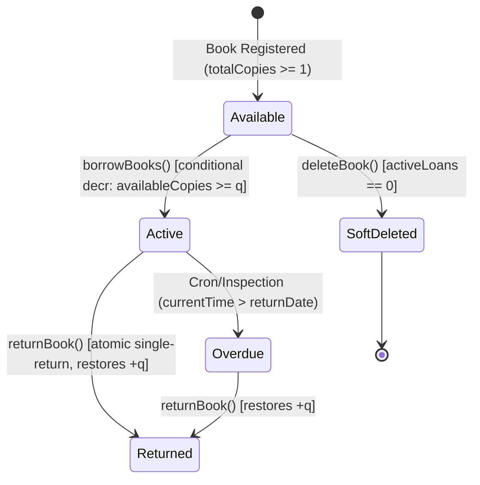

# BookNook Inventory Design & Concurrency Model

## 1. Executive Overview

The BookNook library platform manages physical books that are loaned to readers. Because physical copies are scarce and finite, data integrity and concurrency guarantees are non-negotiable. 

This document defines the mathematical invariants, concurrency control architecture, transactional boundaries, and state transition rules implemented in **Phase 04**.

---

## 2. Core Mathematical Invariants

For every book document in the catalog:

$$\forall b \in \text{Books}: \quad 0 \le b.\text{availableCopies} \le b.\text{totalCopies}$$

$$b.\text{availableCopies} = b.\text{totalCopies} - \sum_{l \in \text{ActiveLoans}(b)} l.\text{quantity}$$

### Invariant Rules Enforced
1. **Non-negativity ($b.\text{availableCopies} \ge 0$)**: An inventory balance can never drop below zero under any concurrency condition.
2. **Upper Bound ($b.\text{availableCopies} \le b.\text{totalCopies}$)**: Available copies can never exceed total physical copies.
3. **Quantity Conservation**: Every borrowed quantity $q \ge 1$ decrements `availableCopies` by exactly $q$. When returned, exactly $q$ is restored.
4. **Active Loan Lower Bound**: `totalCopies` cannot be edited to a value less than the sum of currently borrowed active copies:
   $$\text{newTotal} \ge \sum_{l \in \text{ActiveLoans}(b)} l.\text{quantity}$$

---

## 3. Concurrency & Transactional Architecture

### 3.1 Conditional Atomic Decrement
To prevent overselling/over-borrowing in high-concurrency environments, operations do not rely on in-memory balance checks. Instead, MongoDB conditional atomic updates are executed:

```javascript
const filter = {
  _id: bookId,
  isDeleted: { $ne: true },
  availableCopies: { $gte: requestedQuantity }
};

const update = {
  $inc: { availableCopies: -requestedQuantity },
  $set: { updatedAt: new Date().toISOString() }
};

const res = await booksCollection.updateOne(filter, update, sessionOptions);
if (res.modifiedCount === 0) {
  throw new Error("INSUFFICIENT_COPIES");
}
```

### 3.2 Dual-Tier Transaction Guarantee
- **Primary Tier (Replica Set / MongoDB Atlas)**: Checkouts run inside a multi-document ACID transaction via `session.withTransaction(...)`. If any validation or item in a batch fails, the entire transaction is automatically aborted.
- **Secondary Tier (Standalone Fallback / Compensation Engine)**: If the backend runs against a standalone MongoDB instance or test mock where multi-document sessions are unsupported, `withTransactionOrCompensation` catches the operation and provides automatic inverse-compensation rollbacks, restoring all modified items to their exact prior counts.

### 3.3 All-or-Nothing Batch Checkout (Borrow Bag)
When a reader checks out a Borrow Bag containing $k$ titles $\{b_1, b_2, \dots, b_k\}$:
- The entire batch is processed as a unified atomic transaction.
- If $b_k$ has insufficient stock, or if the reader already has an active loan for $b_j$, the entire checkout is aborted.
- No partial loans are created.

---

## 4. State Machine & Transition Rules



### State Definitions
- **Available**: Physical copies are in the library ($b.\text{availableCopies} > 0$).
- **Active**: Loaned to reader; $b.\text{availableCopies}$ reduced by $q$. Loan deadline is exactly `borrowDate + 14 calendar days`.
- **Returned**: Physical copies returned to the shelf; $b.\text{availableCopies}$ incremented by $q$; `returnedAt` timestamp set.
- **SoftDeleted**: Book is archived (`isDeleted: true`). Historical borrow documents remain fully preserved for relational integrity.

---

## 5. Duplicate Active Loan Prevention

### Dual-Layer Defense
1. **Application Layer**: Before decrementing inventory, `borrowsCollection.findOne({ userId, bookId, status: "Active" })` verifies no concurrent loan exists for the title.
2. **Database Layer (Partial Unique Index)**:
   ```javascript
   db.collection("borrows").createIndex(
     { userId: 1, bookId: 1 },
     {
       unique: true,
       partialFilterExpression: { status: "Active" },
       name: "idx_borrows_unique_active_loan"
     }
   );
   ```
   This index enforces uniqueness **only** while `status == "Active"`. Once returned (`status == "Returned"`), the reader is eligible to borrow the title again in the future.

---

## 6. Return & Deletion Guards

### 6.1 Double-Return Prevention
To prevent multiple increments if a user spams the return button or duplicate network requests arrive:
```javascript
const res = await borrowsCollection.updateOne(
  { _id: borrowId, status: { $ne: "Returned" } },
  { $set: { status: "Returned", returnedAt: new Date().toISOString() } }
);
if (res.modifiedCount === 0) {
  throw new Error("ALREADY_RETURNED");
}
```
Only the first request transitions the record and restores `availableCopies`.

### 6.2 Active Loan Deletion Guard
A book cannot be deleted while physical copies are circulating:
```javascript
const activeLoans = await borrowsCollection.countDocuments({
  bookId: String(id),
  status: "Active"
});
if (activeLoans > 0) {
  throw new Error("CANNOT_DELETE_ACTIVE_LOANS");
}
```
If permitted, the book is marked with `isDeleted: true` (soft deletion) so borrow histories remain intact.

---

## 7. Inventory Reconciliation Audit

The service provides `reconcileInventory({ db })`, accessible via `GET /inventory/reconcile`. 

It audits every title in the catalog by comparing:
$$\Delta = b.\text{availableCopies} - \left(b.\text{totalCopies} - \sum \text{ActiveBorrowQuantities}\right)$$

If $\Delta \ne 0$, the title is reported with its discrepancies without executing destructive overwrites, providing safe operational visibility.

