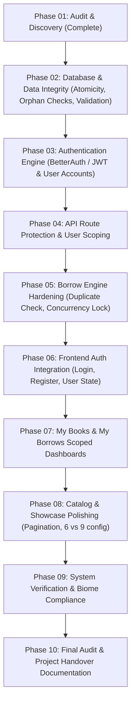

# BookNook — Comprehensive Project Audit & Technical Understanding Report

**Audit Date**: October 31, 2026  
**Auditor**: Antigravity Technical Pair Programmer  
**Repository Scope**: `booknook_client/` (Next.js 16 App Router) and `booksnook_backend/` (Express.js + MongoDB)  

---

## 1. Project Overview

**BookNook** is a digital physical-library management platform designed to facilitate community and institutional book sharing. Unlike traditional bookstore eCommerce applications that process sales and payments, BookNook operates strictly on a **borrow-and-return model**:
- Every title possesses physical inventory: `totalCopies` and `availableCopies`.
- Books are loaned for a standard period of **14 calendar days**.
- Borrowing is free of monetary charge; when all physical copies are loaned out (`availableCopies === 0`), borrowing is automatically locked.
- Readers track loans, return books to restore catalog inventory, and administrators/librarians register new titles and maintain inventory.

### Repository Architecture & Environment
- **Frontend Root**: `c:\Project\Assignment-08\booknook_client` (Git repository on `master`).
  - Next.js 16.4.3 (App Router), React 19.3.0, TypeScript 5.
  - React Compiler enabled (`reactCompiler: true` in `next.config.ts`).
  - Tailwind CSS v4 without legacy `tailwind.config.ts`, configured via `@theme` tokens in `src/app/globals.css`.
  - Biome 2.4.2 linter/formatter (`biome.json`), replacing ESLint & Prettier.
  - Base UI (`@base-ui/react`) and shadcn UI (`components.json`, base-nova style).
  - Environment: `NEXT_PUBLIC_API_URL=http://localhost:8000` (stored in `.env.local` and `.env`).
- **Backend Root**: `c:\Project\Assignment-08\booksnook_backend` (Non-git standalone folder).
  - Node.js ES Module (`"type": "module"`), Express.js 5.3.0.
  - Native MongoDB driver 7.8.0 connecting to MongoDB Atlas cluster (`assignment-08` database).
  - Dotenv 18.0.9 loading `MONGODB_URL`.
  - Port 8000.

---

## 2. Verified Existing Features

The following features were verified through actual source code inspection:
1. **Homepage Hero Banner Carousel** ([`Banner.tsx`](file:///c:/Project/Assignment-08/booknook_client/src/components/banner.tsx)):
   - 3-slide automated carousel with 6-second interval, manual pagination dots, cinematic vignette, and responsive typography.
2. **Dynamic Book Loading** ([`books.ts`](file:///c:/Project/Assignment-08/booknook_client/src/lib/books.ts)):
   - Centralized API fetching with fallback to 8 mock books (`FALLBACK_BOOKS`) if the Express backend is unreachable.
3. **Recent Books Grid Showcase** ([`RecentBooksShowcase.tsx`](file:///c:/Project/Assignment-08/booknook_client/src/components/books/RecentBooksShowcase.tsx)):
   - 3-row × 3-column responsive grid on desktop (`lg:grid-cols-3`), 9 skeleton loaders during loading state.
4. **Interactive Book Cards** ([`BookCard.tsx`](file:///c:/Project/Assignment-08/booknook_client/src/components/books/BookCard.tsx)):
   - Displays cover image, category badge, rating stars, copy availability status (`X of Y Left` / `Out of Copies`), and disabled borrow state when copies reach 0.
5. **Book Catalog Page** ([`src/app/books/page.tsx`](file:///c:/Project/Assignment-08/booknook_client/src/app/books/page.tsx)):
   - Real-time client-side search filtering by title/author.
   - Category filtering pills ("All", "Fiction", "Non-Fiction", "Sci-Fi", "Mystery", "Technology", "Finance").
   - Multi-option sorting (Default, Available Copies Descending, In-Stock Only, Highest Rated).
   - Direct link to `+ Add Book` in the catalog banner.
   - Search parameters wrapped inside `<Suspense>` for Next.js App Router compliance.
6. **Book Details Page** ([`src/app/books/[id]/page.tsx`](file:///c:/Project/Assignment-08/booknook_client/src/app/books/[id]/page.tsx)):
   - Complete layout showing title, author, rating, synopsis, specifications matrix (pages, language, publisher, publication year).
   - Availability banner (14-day loan tag, copy availability indicator).
   - Quantity selector bounded between `1` and `availableCopies`.
   - Related books recommendation section.
7. **Add Book Form** ([`src/app/add-book/page.tsx`](file:///c:/Project/Assignment-08/booknook_client/src/app/add-book/page.tsx)):
   - Validated inputs for Title, Author, Category, Copies (min 1), Rating, Image URL, Description.
   - 5 one-click preset cover image selectors.
   - Synchronous real-time live preview card reflecting user input.
   - Backend dispatch via `POST /books` with success confirmation banner.
8. **My Books Inventory Dashboard** ([`src/app/my-books/page.tsx`](file:///c:/Project/Assignment-08/booknook_client/src/app/my-books/page.tsx)):
   - Summary stat cards: Total Books, Total Copies, Available Copies, Currently Loaned.
   - Tabular view with cover thumbnails, category, copy metrics, and status badges.
   - Real-time search and category filtering within owned inventory.
   - Inline **Edit Book Modal** updating title, author, category, total copies, and available copies (`PUT /books/:id`).
   - Confirmation dialog for **Delete Book** (`DELETE /books/:id`).
9. **My Borrows Reader Dashboard** ([`src/app/my-borrows/page.tsx`](file:///c:/Project/Assignment-08/booknook_client/src/app/my-borrows/page.tsx)):
   - Metrics cards: Total Borrows, Active Loans, Overdue, Returned.
   - Filter tabs: All, Active Loans, Overdue, Returned.
   - Loan cards with cover image, title, author, borrowed date, and return due date.
   - Dynamic countdown badges (days remaining, due today, overdue alert).
   - **Return Book** workflow that updates status to `Returned` and restores book copies in catalog.
10. **Borrow Bag Drawer** ([`CartSheet.tsx`](file:///c:/Project/Assignment-08/booknook_client/src/components/header/CartSheet.tsx)):
    - Slide-out sheet displaying queued borrow requests.
    - Quantity controls capped at `availableCopies`.
    - 14-day return due date calculation.
    - Confirm Borrow action creating borrow records and clearing the bag.
11. **Theming & Color System** ([`theme-provider.tsx`](file:///c:/Project/Assignment-08/booknook_client/src/providers/theme-provider.tsx)):
    - Dark green primary palette tokens.
    - Light, Dark, and System theme toggling with OS preference synchronization and `localStorage` persistence.
12. **Responsive Navigation** ([`Header.tsx`](file:///c:/Project/Assignment-08/booknook_client/src/components/Header.tsx), [`Navbar.tsx`](file:///c:/Project/Assignment-08/booknook_client/src/components/Navbar.tsx), [`MobileNavSheet.tsx`](file:///c:/Project/Assignment-08/booknook_client/src/components/header/MobileNavSheet.tsx)):
    - Sticky desktop navbar and slide-out mobile drawer covering all active routes.
13. **Footer** ([`Footer.tsx`](file:///c:/Project/Assignment-08/booknook_client/src/components/Footer.tsx)):
    - 4-column design with logo, newsletter subscription feedback, account links, footer menu, and store details.

---

## 3. Partially Implemented Features

1. **Latest-Six-Book Showcase vs. 3x3 Grid**:
   - The initial project specification requested showcasing the latest 6 books. Prompt 8 asked for a 3-row × 3-column (9 books) layout. Current code in `RecentBooksShowcase.tsx` slices 9 items (`data.slice(0, 9)`). If an evaluation strictly asserts exactly 6 books, this will cause a mismatch.
2. **Borrow Bag Checkout Flow**:
   - Confirming a borrow creates records and updates the database, but does not collect or associate a verified user identity (currently hardcodes `"Student Reader"` and `"reader@booknook.com"`).
3. **Newsletter Subscription**:
   - Displays interactive client-side success state ("Thank you for subscribing!"), but does not persist newsletter subscribers to any backend collection or mailing list.
4. **Mock Navigation Data Mismatch**:
   - `public/data/nav_data.ts` references `/books-add`, whereas `Navbar.tsx` uses `/add-book`. While `Navbar.tsx` is the actual rendered component, `public/data/nav_data.ts` is orphaned and inconsistent.

---

## 4. Missing Features

1. **Authentication System**:
   - No authentication libraries installed (no `better-auth`, `@auth/core`, `next-auth`, or `jsonwebtoken`).
   - No login, registration, or logout endpoints.
   - Missing routes: `/login`, `/register`, `/account`. Clicking these links in `Navbar` or `Footer` renders a 404 page.
2. **Authorization & Role-Based Access Control (RBAC)**:
   - No distinction between a Librarian/Admin (who can add, edit, or delete books) and a regular Reader/Student (who can only borrow and return).
3. **User-Owned Borrow Filtering**:
   - In `/my-borrows`, all borrow records in the collection are displayed rather than filtering by the logged-in user's identity.
4. **Static Information Pages**:
   - Missing routes: `/contact`, `/privacy`, `/terms`.

---

## 5. Frontend Problems

1. **Unauthenticated Identity Spoofing**:
   - Frontend components (`CartSheet`, `add-book`) construct user metadata on the client side and post it directly to the backend.
2. **Dead Links in Navigation & Footer**:
   - `/login`, `/register`, `/account`, `/contact`, `/privacy`, `/terms` lead to 404s.
3. **No Optimistic Rollback on API Failure**:
   - In `/my-books` and `/my-borrows`, if an update or return API call fails after state change, some views lack rollback to original state unless refreshed.
4. **Local Fallback Desynchronization**:
   - When the backend server is offline, fallback books and `localStorage` borrow records are used. However, modifications made while offline are not queued or synchronized once the backend comes online.

---

## 6. Backend Problems

1. **Non-Atomic Borrow and Inventory Updates (Race Condition)**:
   - In `POST /borrows`, the borrow record is inserted and then a separate `updateOne` decrements `availableCopies`.
   - **Critical concurrency bug**: If 2 users attempt to borrow the final copy (`availableCopies: 1`) simultaneously, both requests pass the client check and decrement inventory, resulting in `availableCopies: -1`.
   - There is no atomic check `{ availableCopies: { $gte: quantity } }` in the MongoDB query.
2. **Uncaught MongoDB Startup Failures**:
   - `const dataBase = await connectToMongoDB();` executes at module load time. If the connection fails, `dataBase` is `undefined`, and incoming requests crash with unhandled `TypeError: Cannot read properties of undefined (reading 'db')`.
3. **No Request Payload Validation Schema**:
   - Backend APIs do not use validation libraries (e.g., Zod, Joi). Bad types (such as `copies: "five"` or negative numbers) can corrupt MongoDB document schemas.
4. **No CORS Origin Whitelisting**:
   - `res.header("Access-Control-Allow-Origin", "*")` allows all domains to trigger write/delete operations against the API.

---

## 7. Database Problems

1. **No Indexes on Query Fields**:
   - `assignment-08.books` lacks indexes on `category`, `createdAt`, or `title`.
   - `assignment-08.borrows` lacks indexes on `bookId`, `borrowerEmail`, or `status`.
   - As data scales, queries will perform slow full-collection scans.
2. **Orphaned Records on Book Deletion**:
   - `DELETE /books/:id` removes the book document regardless of active loans. If a book with active loans is deleted:
     - Readers holding copies cannot see details.
     - When the reader returns the book (`PUT /borrows/:id/return`), the increment query fails to match any book document, permanently losing physical copy tracking.
3. **Inconsistent Schema Formats in Seed Data**:
   - Some legacy records use `bookTitle`, `authorName`, `coverImage`, while newer records use `title`, `author`, `image`. The frontend has to maintain defensive normalization (`normalizeBook`) to handle schema fragmentation.

---

## 8. Security Problems

1. **Unprotected Private APIs (Critical P0)**:
   - `POST /books`, `PUT /books/:id`, `DELETE /books/:id` are completely unauthenticated. Anyone on the internet can delete the entire library catalog by sending HTTP DELETE requests.
2. **No User Ownership Verification**:
   - Any user can return any other user's borrow record or edit another user's contributed book.
3. **Plaintext Secrets in Local `.env`**:
   - `.env` files must be strictly guarded and kept out of public commits (currently `.gitignore` includes `.env*`, which is correct; however, sample connection strings must not be committed to GitHub).

---

## 9. API Inconsistencies

1. **ID Handling Fragmentation**:
   - MongoDB creates `_id` as `ObjectId`. Some fallback records use string IDs like `"book-1"`. The backend currently uses `$or: [{ _id: new ObjectId(id) }, { _id: id }]` defensively, but query performance is degraded without uniform ID hygiene.
2. **Status Field Redundancy**:
   - Books maintain both `available: boolean` and `status: "Available" | "Unavailable"`. If one is updated without the other, frontend badges and backend filters become out of sync.

---

## 10. Performance Issues

1. **Full Collection Scans on Homepage & Catalog**:
   - `GET /books` returns the entire books collection as an unpaginated array (`.find({}).toArray()`). When the library grows to thousands of books, this will cause high memory usage and slow response times.
2. **Unoptimized Remote Images**:
   - Remote Unsplash and ImageKit images use `unoptimized` flag in `next/image` to bypass Next.js image domain configuration restrictions. While safe from loader crashes, it transfers full-resolution multi-megabyte images to mobile clients.

---

## 11. Priority Classification

| Priority | Category | Issues Identified |
| :--- | :--- | :--- |
| **P0** | **Security & Data Integrity** | Unprotected APIs (anyone can add/edit/delete books); Race condition allowing negative `availableCopies`; Deleting books with active loans causing orphaned records; No atomicity on borrow/return. |
| **P1** | **Mandatory Functionality** | BetterAuth authentication implementation; User session verification; Associating borrow records with authenticated user email/ID; Connecting private endpoints to verified JWT/session guards. |
| **P2** | **Quality & UX** | Creating `/login`, `/register`, `/account` pages; Resolving 6 vs 9 book showcase requirement; Adding pagination/limiting to `GET /books`; Atomic MongoDB `$inc` with `$gte` check. |
| **P3** | **Optional Improvements** | Static information pages (`/contact`, `/privacy`, `/terms`); Image optimization domain whitelisting in `next.config.ts`; Newsletter persistence to database. |

---

## 12. Recommended Fixes

1. **Atomic Inventory Mutation with MongoDB `findOneAndUpdate`**:
   ```javascript
   // In POST /borrows:
   const bookUpdate = await booksCollection.findOneAndUpdate(
     { _id: targetId, availableCopies: { $gte: quantity } },
     { $inc: { availableCopies: -quantity } },
     { returnDocument: "after" }
   );
   if (!bookUpdate) {
     return res.status(400).json({ message: "Insufficient available copies to borrow." });
   }
   ```
2. **Prevent Deleting Books with Active Loans**:
   ```javascript
   // In DELETE /books/:id:
   const activeLoans = await borrowsCollection.countDocuments({ bookId: id, status: "Active" });
   if (activeLoans > 0) {
     return res.status(400).json({ message: "Cannot delete book while active borrow loans exist." });
   }
   ```
3. **Authentication Layer Installation**:
   - Install and configure BetterAuth or lightweight JWT auth for user registration, login, and session cookies/tokens.
   - Attach authentication middleware to `POST /books`, `PUT /books/:id`, `DELETE /books/:id`, `POST /borrows`, `PUT /borrows/:id/return`.
4. **Scoped Borrows Query**:
   - `GET /borrows` should take user context into account: `borrowsCollection.find({ borrowerEmail: req.user.email })` so users only see their own active and historical borrows.
5. **Database Connection Robustness**:
   - Wrap `MongoClient` connection in an express middleware or ensure reconnection retry logic before handling requests.

---

## 13. Implementation Dependency Map



---

*Report filed in `docs/PROJECT_AUDIT.md`. Code changes deferred until designated phase.*
