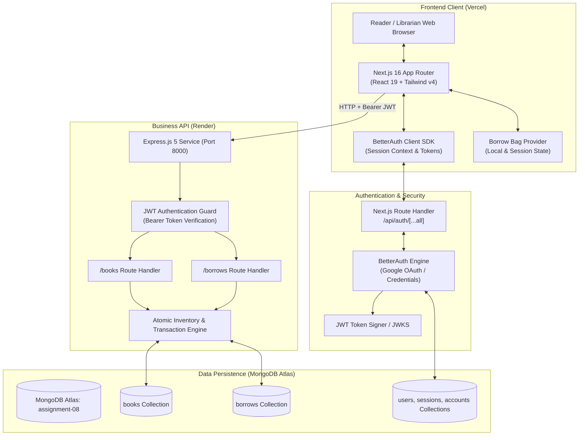
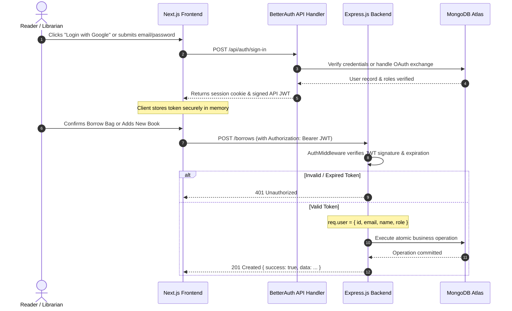
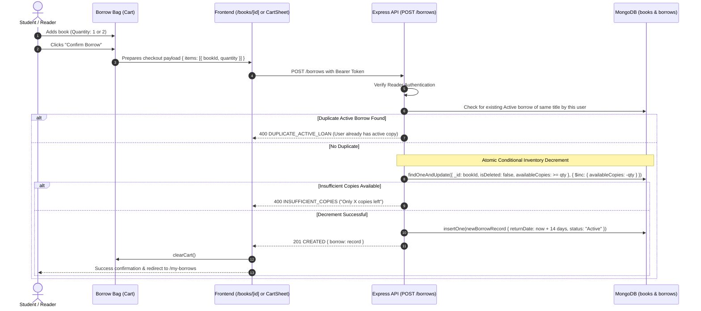
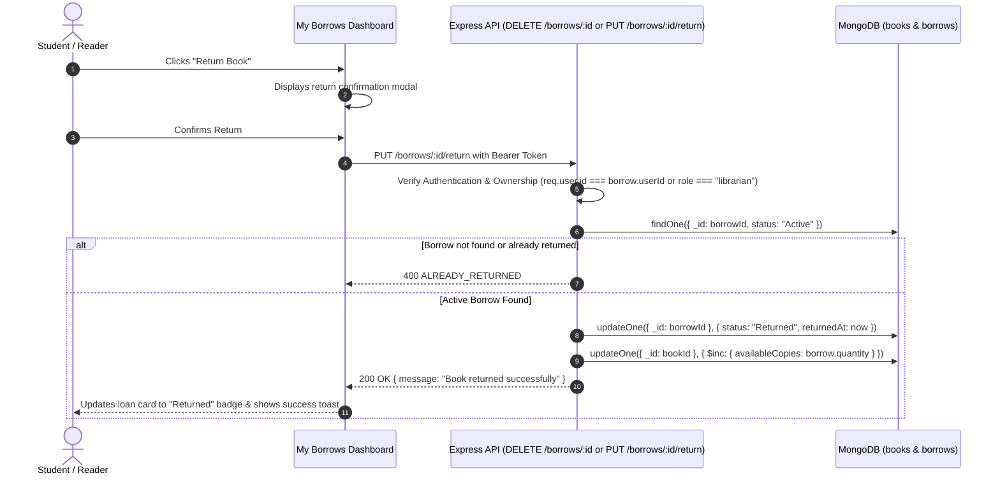

# BookNook — System Architecture Specification

**Version**: 1.0.0 (Phase 02 Architecture Contract)  
**Status**: APPROVED DESIGN  
**Date**: October 31, 2026  

---

## 1. High-Level Architecture Overview

BookNook is architected as a modern, decoupled full-stack application separating user-facing rendering, authentication orchestration, business logic, and transactional database persistence.

---

## 2. Core Technological Components

| Layer | Technology | Primary Role | Hosting / Runtime |
| :--- | :--- | :--- | :--- |
| **Frontend** | Next.js 16 (App Router), React 19, TypeScript | Server and Client Components, fast edge rendering, client-side UI state, live previews | Vercel Serverless / Edge |
| **Authentication** | BetterAuth (`better-auth`) | User signup, login, Google OAuth, session cookies, JWT token issuance for backend calls | Next.js API Route (`/api/auth/*`) |
| **Business API** | Express.js 5.3 (ESM) | Business logic validation, inventory invariant protection, atomic borrow/return transactions | Render Web Service |
| **Database** | MongoDB 7.8 Native Driver | Document database storing books, borrow contracts, and auth accounts | MongoDB Atlas Dedicated/Serverless |
| **Styling & UI** | Tailwind CSS v4, Base UI, shadcn | Themeable UI tokens (`@theme`), Dark Green primary palette, responsive layout | Client Bundle |
| **Code Hygiene** | React Compiler + Biome 2.4 | Automated memoization, strict linting, zero ESLint/Prettier conflicts | Development Tooling |

---

## 3. End-to-End Authentication Architecture

BetterAuth runs directly inside the Next.js application as a route handler (`/api/auth/[...all]`). When requests are made from the frontend to the Express backend (`http://localhost:8000` or production Render API), a signed JSON Web Token (JWT) is attached in the `Authorization: Bearer <token>` header.

### Express JWT Verification Strategy
1. The Express server uses a lightweight verification middleware (`jsonwebtoken` or `@better-auth/jwt`).
2. The shared secret (`BETTER_AUTH_SECRET` or `JWT_SECRET`) is shared securely between Next.js and Express via environment variables.
3. Every authenticated route receives `req.user` populated with:
   - `id`: Unique User ObjectId string.
   - `email`: Authenticated email address.
   - `name`: User full name.
   - `role`: Role (`"reader"` or `"librarian"`).

---

## 4. End-to-End Borrowing Flow

The borrow operation enforces **zero partial checkouts**, **atomic inventory decrements**, and **concurrency protection**.

---

## 5. End-to-End Return Flow

Returning a book restores library inventory while preserving complete historical audit trails.

---

## 6. Hosting and Deployment Topology

- **Frontend (Vercel)**:
  - Custom domain or Vercel production URL.
  - Environment variables: `NEXT_PUBLIC_API_URL` (points to Render backend), `BETTER_AUTH_SECRET`, `GOOGLE_CLIENT_ID`, `GOOGLE_CLIENT_SECRET`.
- **Backend (Render Web Service)**:
  - Docker or Node.js environment (`node index.js`).
  - Environment variables: `PORT=8000`, `MONGODB_URL` (Atlas connection string), `BETTER_AUTH_SECRET` (shared for JWT validation), `ALLOWED_ORIGIN` (Vercel domain).
- **Database (MongoDB Atlas)**:
  - M0 or Serverless Atlas instance in the same regional data center (e.g., AWS us-east-1 or ap-southeast-1) to minimize network latency between Render and MongoDB.

---

*Specification authored in accordance with Phase 02 requirements.*

